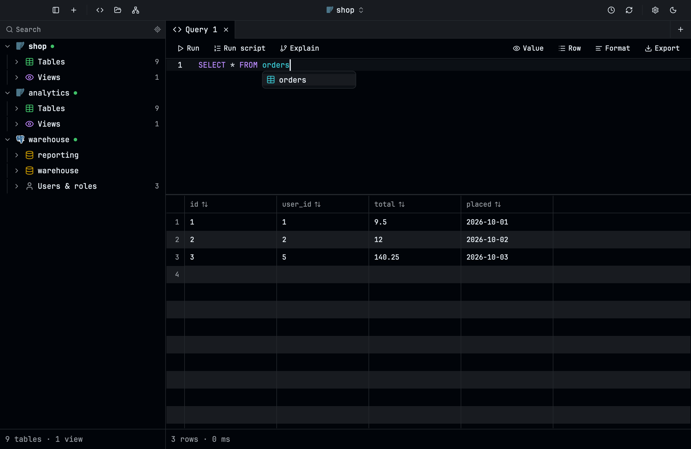
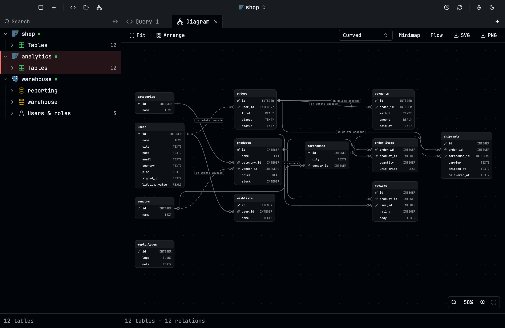
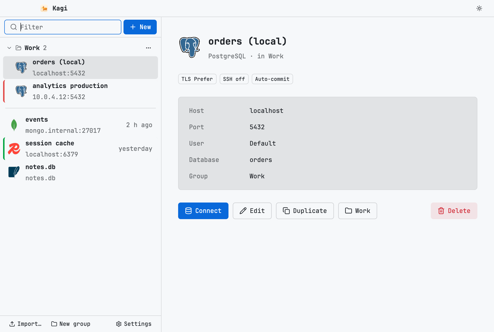
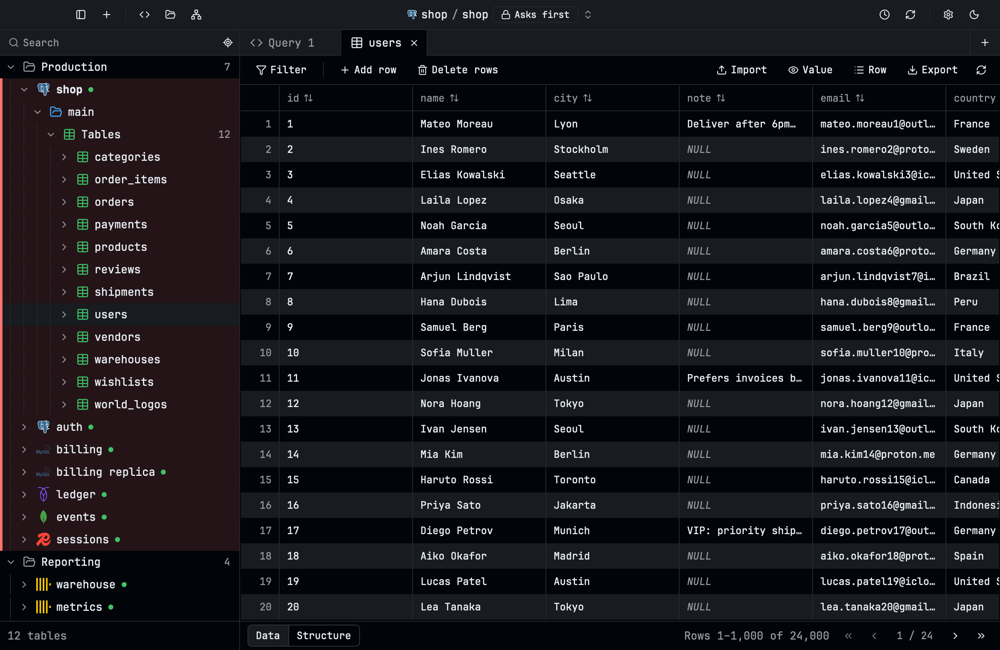

<p align="center">
  <picture>
    <source media="(prefers-color-scheme: dark)" srcset="media/kagi-icon-dark.png">
    
  </picture>
</p>

<h1 align="center">Kagi releases</h1>

<p align="center">Builds of Kagi, a fast, lightweight database client for SQL, NoSQL and object storage.</p>

<p align="center">
  <a href="https://github.com/apitamr/kagi-releases/releases/latest"></a>
  <a href="https://github.com/apitamr/kagi-releases/releases"></a>
</p>

<p align="center">
  
</p>

| Running a query | A schema's diagram | Saved connections |
| --- | --- | --- |
|  |  |  |



The video and screenshots show sample data.

Click your system's button to download its file from the [latest release](https://github.com/apitamr/kagi-releases/releases/latest), then follow its section below.

The Linux buttons are for Intel and AMD (x86-64). For 64-bit ARM (ARM laptops and servers, Linux on Apple silicon), the release has the same .deb, AppImage, Flatpak and snap built for it (`arm64`, `aarch64`); the APT and Flatpak repositories serve both.

| System | Download | Updates |
| --- | --- | --- |
| macOS (Apple Silicon) | [](https://github.com/apitamr/kagi-releases/releases/download/v0.5.3/kagi-0.5.3.dmg) | Download the new version when Kagi says there is one |
| Windows (x64) | [](https://github.com/apitamr/kagi-releases/releases/download/v0.5.3/kagi-0.5.3-x64.msi) | Installs them itself |
| Linux, any distribution | [](https://github.com/apitamr/kagi-releases/releases/download/v0.5.3/kagi-0.5.3-x86_64.AppImage) | Installs them itself |
| Linux, any distribution (Flatpak) | [](https://github.com/apitamr/kagi-releases/releases/download/v0.5.3/kagi-0.5.3-x86_64.flatpak) | Installs them itself, or `flatpak update` |
| Debian, Ubuntu | [](https://github.com/apitamr/kagi-releases/releases/download/v0.5.3/kagi_0.5.3_amd64.deb) | Installs them itself, or Software Updater |
| Arch, Omarchy | `curl -fsSL https://apitamr.github.io/kagi-releases/arch/setup.sh \| sh` | Installs them itself, or `pacman -Syu` |

## macOS

Kagi isn't signed with an Apple Developer ID yet, so macOS can't check it and blocks it the first time. You allow it once:

1. Open the `.dmg` and drag **Kagi** into **Applications**.
2. Open Kagi. macOS says it can't verify it: click **Done**, not Move to Trash.
3. Open **System Settings › Privacy & Security**, scroll to **Security**, and click **Open Anyway** next to the message about Kagi. Confirm with your password or Touch ID.
4. Kagi opens, and from now on it opens like any other app.

Or, in Terminal, after step 1:

```sh
xattr -dr com.apple.quarantine /Applications/Kagi.app
```

**After each update**, macOS treats the new copy as a different app until Kagi is signed:

- You may need to allow it again as above.
- macOS asks once more before Kagi can read each saved password from your keychain. Click **Always Allow**.

Right-clicking the app and choosing Open no longer gets past this on macOS 15 and later; use Privacy & Security.

## Windows

The installer isn't code-signed yet, so Windows SmartScreen may stop it.

1. Run the `.msi`. If **Windows protected your PC** shows, click **More info**, then **Run anyway**.
2. Follow the installer. Kagi is in the Start menu.

Kagi checks for updates and installs them itself.

## Linux

### AppImage (any distribution)

```sh
chmod +x kagi-*-x86_64.AppImage
./kagi-*-x86_64.AppImage
```

AppImages need FUSE 2. If it doesn't start, install it: `sudo pacman -S fuse2` on Arch, `sudo apt install libfuse2` on Debian and Ubuntu (`libfuse2t64` on Ubuntu 24.04 and later).

Kagi checks for updates and installs them itself.

### Flatpak (any distribution)

```sh
flatpak install --user https://apitamr.github.io/kagi-releases/kagi.flatpakref
```

or open the downloaded `.flatpak` (`flatpak install --user kagi-*-x86_64.flatpak`). Either way it fetches the runtime from Flathub if you don't have it, and updates from Kagi's repository: Kagi's **Update** installs the new version and restarts into it, and `flatpak update` or your software centre do too. Inside Flatpak's sandbox:

- SSH tunnels work, as `ssh` comes with it, signing with your SSH agent's keys or a key file you pick; `~/.ssh` (its config and known hosts) is out of its reach.
- It opens and saves files (SQLite and DuckDB databases, `.sql` files, exports) through the file picker; a path typed by hand isn't reachable.
- Dumping and restoring don't, as `pg_dump`, `mysqldump` and the others aren't in the sandbox. Use another package for those.
- Connect to local servers over TCP (`localhost`), not their Unix sockets.
- Its saved connections are kept apart from another install's, in `~/.var/app/io.github.apitamr.kagi_releases.Kagi`.

### Debian and Ubuntu

```sh
sudo apt install ./kagi_*_amd64.deb
```

or open it in your software centre. It adds Kagi's APT repository, so Software Updater brings new versions, and Kagi's **Update** installs them itself (asking for your password in the system's dialog).

### Arch and Omarchy

```sh
curl -fsSL https://apitamr.github.io/kagi-releases/arch/setup.sh | sh
```

It trusts Kagi's signing key, adds the `[kagi]` repository to `/etc/pacman.conf` and installs `kagi-bin`; `pacman -Syu` (and Omarchy's Update) keep it up to date, and Kagi's **Update** installs a new version itself (asking for your password in the system's dialog).

Or build it by hand: download the release's tarball and `PKGBUILD` into one folder, then run `makepkg -si` there; `pacman -Syu` doesn't update that copy, but Kagi's **Update** still does.

For SSH tunnels Kagi uses `ssh` (`openssh`); for dumps and restores, `pg_dump` and `psql` (`postgresql`) or `mysqldump` and `mysql` (`mariadb-clients`).

Kagi then shows in your app launcher. On Omarchy it follows your theme, light or dark, unless you turn that off in its Settings.

It is coming to the AUR as `kagi-bin`, for `yay -S kagi-bin` and Omarchy's **Install › AUR**.

To remove it: `sudo pacman -R kagi-bin`.

## License

Kagi is free to download and use, at home and at work. It isn't open source: see [LICENSE.txt](LICENSE.txt) for what you may and may not do with it.

## About this repository

It holds the builds only; the source is private. Kagi checks this repository's latest release for updates.
